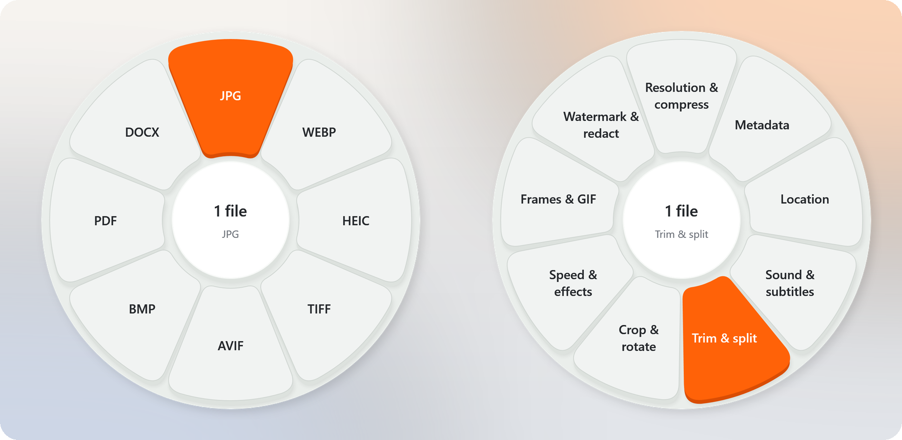
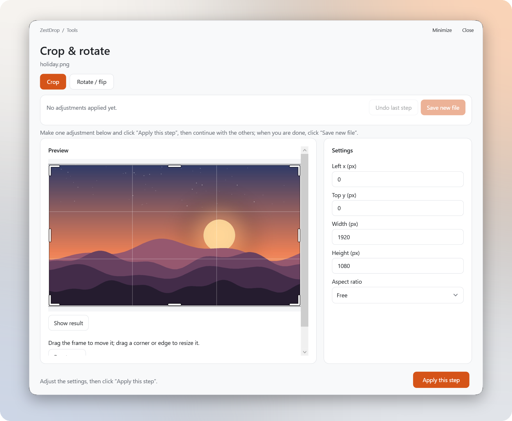
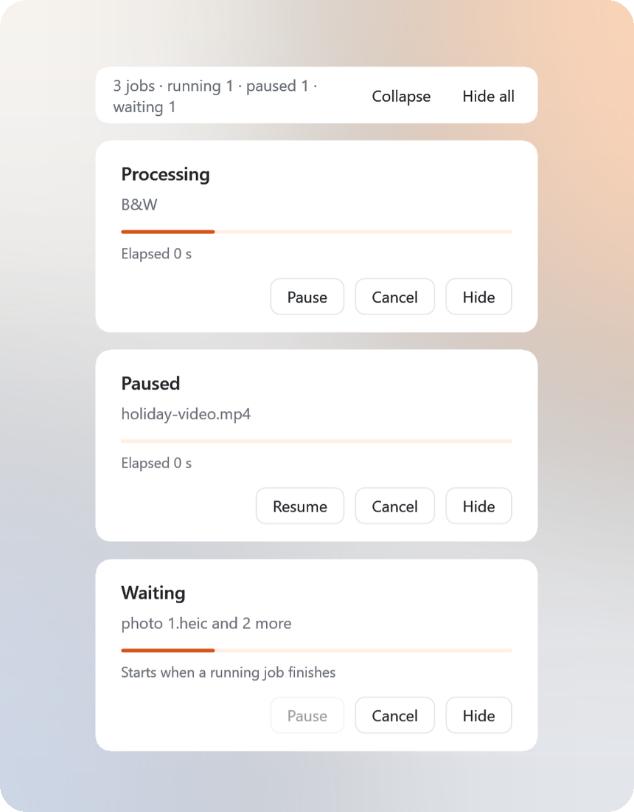
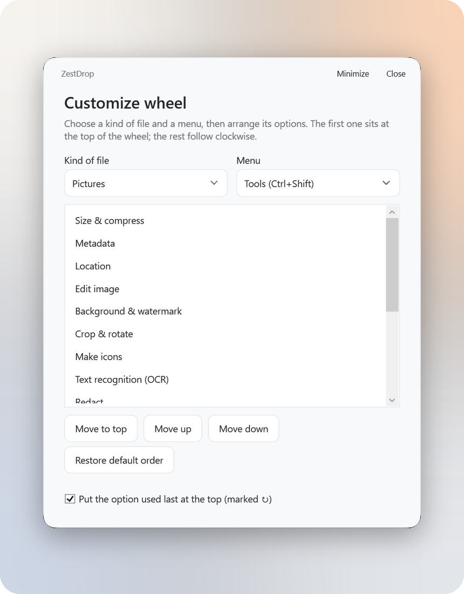

<div align="center">


# ZestDrop

**Drag. Drop. Convert.**

A free file converter for Windows that lives in the system tray. Hold **Shift** while dragging any file, and a wheel of formats appears under your cursor. Drop on one to convert.

[Website](https://zestdrop.org) · [Microsoft Store](https://apps.microsoft.com/detail/9NG514X8RQC6) · [Download v1.1.1](#download) · [使用指南（中文）](docs/usage.md)

</div>

<picture>
  <source media="(prefers-color-scheme: dark)" srcset="docs/images/wheels-dark.png" />
  
</picture>

- **341 conversions and 48 tools** across images, video, audio, documents and archives.
- **No main window.** The wheel appears while you drag, and the result is saved next to the original file.
- **Works offline.** Files are processed on your PC and never uploaded. ZestDrop does not connect to the internet.
- **Everything included.** The download bundles .NET, Python, FFmpeg and 7-Zip; there is nothing else to install.
- **English, Simplified Chinese and Arabic**, with light and dark appearances.

## Download

Windows 10 version 1809 or later, x64.

| | Download | Size |
| --- | --- | --- |
| **Microsoft Store** | [Get ZestDrop from the Microsoft Store](https://apps.microsoft.com/detail/9NG514X8RQC6) | Installs and updates through the Store |
| **Online installer** | [ZestDrop-v1.1.1-windows-x64-online-setup.exe](https://github.com/Maxaccurate/ZestDrop/releases/download/v1.1.1/ZestDrop-v1.1.1-windows-x64-online-setup.exe) | 2.2 MB to start; downloads and verifies the 150.0 MB installer |
| **Offline installer** | [ZestDrop-v1.1.1-windows-x64-setup.exe](https://github.com/Maxaccurate/ZestDrop/releases/download/v1.1.1/ZestDrop-v1.1.1-windows-x64-setup.exe) | 150.0 MB |
| **Portable 7z** | [ZestDrop-v1.1.1-windows-x64.7z](https://github.com/Maxaccurate/ZestDrop/releases/download/v1.1.1/ZestDrop-v1.1.1-windows-x64.7z) | 148.0 MB |
| **Portable ZIP** | [ZestDrop-v1.1.1-windows-x64.zip](https://github.com/Maxaccurate/ZestDrop/releases/download/v1.1.1/ZestDrop-v1.1.1-windows-x64.zip) | 242.1 MB |

All GitHub downloads contain the same complete application. The installers install for the current user (no administrator rights), add a Start menu shortcut and an uninstaller, and offer an optional desktop shortcut. For a portable bundle, extract the whole archive and run `ZestDrop.exe` from the `ZestDrop` folder; keep `backend`, `runtime` and the DLLs next to it.

The GitHub builds are unsigned, so Windows SmartScreen may warn on first launch. See the [release notes](https://github.com/Maxaccurate/ZestDrop/releases/tag/v1.1.1) and [installation and packaging](docs/windows-installer.md) for upgrades and uninstalling.

## How to use it

1. Start dragging one or more files on the desktop or in File Explorer.
2. Press **Shift** for the format wheel, or **Ctrl+Shift** for the tools wheel. You can let go of the keys once the wheel appears.
3. Release the mouse on an option. Conversions start right away; tools that need settings open a small window.

| While dragging | |
| --- | --- |
| **Shift** / **F8** | Formats |
| **Ctrl+Shift** / **F9** | Tools |
| **Esc**, or release outside the wheel | Cancel |

F8 and F9 also work for drags started in other apps. They are not global hotkeys: when you are not dragging, other apps receive them as usual.

New files are saved next to the originals and never overwrite anything; a duplicate name gets a number. Right-click the tray icon to open the latest result, show or cancel jobs, and change settings.

## Screenshots

<picture>
  <source media="(prefers-color-scheme: dark)" srcset="docs/images/crop-rotate-dark.png" />
  
</picture>

<p align="center"><strong>Related tools share one window.</strong> Apply one step, continue on the result, undo if needed, and save once.</p>

<table>
  <tr>
    <td width="50%" align="center">
      <picture>
        <source media="(prefers-color-scheme: dark)" srcset="docs/images/progress-dark.png" />
        
      </picture>
      <br /><strong>Progress cards</strong><br />Pause, resume, cancel or hide each job.
    </td>
    <td width="50%" align="center">
      <picture>
        <source media="(prefers-color-scheme: dark)" srcset="docs/images/customize-wheel-dark.png" />
        
      </picture>
      <br /><strong>Customize wheel</strong><br />Put the options you use most at the top.
    </td>
  </tr>
</table>

## What it can do

| | Formats | Tools |
| --- | --- | --- |
| **Images** | JPG, PNG, WebP, HEIC, TIFF, AVIF, BMP, SVG input; PDF, and DOCX from JPG/PNG | Compress, metadata, location, colour and light adjustments, backgrounds and shadows, crop, rotate by any angle and flip, resize, watermark, icon sets, text recognition (OCR), redaction, animations, collages, combine into a PDF |
| **Video** | MP4, MOV, MKV, WebM, AVI, WMV, GIF; extract MP3 | Compress, metadata, location, trim, split, crop, rotate, resolution and frame rate, speed (keeps the pitch), fades, reverse and loop, subtitles and soundtracks, watermark, timed redaction, frame capture, contact sheets, GIF, join |
| **Audio** | MP3, M4A, WAV, FLAC, OGG, Opus, AIFF, WMA | Compress, metadata, loudness normalisation, trim and silence removal, channels and balance, volume and fades, noise reduction, join, ringtones (.m4r), visualiser videos, beep redaction |
| **Documents** | PDF → DOCX, JPG, PNG, TXT; TXT ↔ PDF, images, SRT, VTT; Word, Excel and PowerPoint exports | PDF compress, merge, split, reorder, rotate and remove pages, passwords, page numbers, headers and footers, extract images, watermark, redaction, searchable PDF (OCR) |
| **Archives** | ZIP, TAR, GZIP, RAR, 7z | Extract, convert, pack files and folders, AES-256 passwords, split volumes |

The wheel shows only what fits the files you drag; with several files selected it shows the operations they all support. Layout-preserving Office exports need the matching desktop Microsoft Word, Excel or PowerPoint.

### More features

- **Combined tool windows.** When a single photo or video has ten or more tools, related tools share one wheel option and one window, such as **Crop & rotate**, **Size & compress** or **Sound & subtitles**. Prefer the older layout? Choose the two-level wheel on the welcome screen or in the tray menu.
- **Location.** See where a photo or video says it was taken, then remove that location or set a new one by pasting coordinates or borrowing another photo's. Nothing else changes, and JPEGs are not re-encoded.
- **Redact PDF.** Black out marked areas and any text you type. The content underneath is removed from the file, not just covered.
- **Background jobs.** Each job gets a progress card in the corner of the screen. Two jobs run at once and the rest wait their turn; pausing a job suspends it completely, including FFmpeg.
- **Audio and video previews.** Tool windows have a player with a seek bar and volume, draggable trim handles, and previews of the effect before you save.
- **Sticky wheel** (optional) keeps the wheel open after you release the mouse, so you can hover and click instead.
- **Appearance and language.** Match Windows, Light or Dark; English, 简体中文 or العربية (right-to-left). Both are in the tray menu.

See the [usage guide](docs/usage.md) (in Chinese) for every feature and its limits.

## Privacy

ZestDrop works entirely on your PC. It has no account, no telemetry and no network access, and your files are never uploaded. Settings are stored in `%LOCALAPPDATA%\ZestDrop\settings.json` and logs in `%LOCALAPPDATA%\ZestDrop\logs`. The full policy is at [zestdrop.org/privacy](https://zestdrop.org/privacy).

## Build from source

Requires Windows x64 and the .NET 10 SDK. Preparing the portable runtime also needs Python 3.13 with pip and 64-bit 7-Zip (in its default location, or pass its folder).

```powershell
# Download portable Python and FFmpeg, install pinned packages, and copy 7-Zip
python work/prepare-runtime.py

# Build the self-contained app and copy the Python backend
./build.ps1

# Start the tray app
./outputs/ZestDrop/ZestDrop.exe
```

- 7-Zip elsewhere: `python work/prepare-runtime.py --sevenzip-dir "D:/Tools/7-Zip"`.
- Already have a complete bundle? Copy its `runtime` folder to `outputs/ZestDrop/runtime` and run `build.ps1`. `./build.ps1 -SkipRuntimeCheck` builds the C# app without checking the runtime.
- Release packages: `package-exe.ps1` (offline installer), `package-online-exe.ps1` (online installer) and `package-msix.ps1` (Microsoft Store). See [installation and packaging](docs/windows-installer.md).

### Project structure

| Path | Contents |
| --- | --- |
| `work/ZestDrop/` | C# WPF app: drag detection, the wheel, tool windows, progress cards and the Office bridge |
| `work/ZestDrop/backend/` | Python engines for images, media, documents and archives |
| `work/F9Checks/`, `work/ProgressChecks/` | C# checks for tool parameters, progress and wheel behaviour |
| `work/test-*.py` | Backend and app dispatch checks using generated fixtures |
| `packaging/` | Inno Setup installer definitions, the Microsoft Store manifest, logos, listing text and screenshots |
| `docs/` | Usage guide, release notes, installer notes and validation records |
| `outputs/` | Build output, runtimes and reports (ignored by Git) |

<details>
<summary><strong>Microsoft Store package</strong></summary>

`./package-msix.ps1` builds the app (`-SkipBuild` reuses `outputs/ZestDrop`) and packs it into `outputs/msix/ZestDrop_<version>_x64.msix` with the Windows SDK's `makeappx`. The package is unsigned on purpose: upload it in Partner Center and the Store signs it. The identity values in `packaging/AppxManifest.xml` come from Partner Center. `packaging/store-listing.md` has the listing text, and `packaging/make-screenshots.py` rebuilds the screenshots from the app's debug render modes.

Before uploading, run `./outputs/ZestDrop/runtime/python/python.exe packaging/check-package.py`. It opens the built `.msix` as a zip (nothing is installed) and checks the manifest, logo sizes, installed path lengths, stray logs, caches or debug files, and the license notices. A Store install is read-only, so ZestDrop writes nothing next to its own files.

</details>

<details>
<summary><strong>Validation</strong></summary>

C# checks that need neither Office nor the portable runtime:

```powershell
New-Item -ItemType Directory -Force outputs | Out-Null
dotnet run --project work/F9Checks -- outputs/f9-parameter-tests.json
dotnet run --project work/ProgressChecks -- outputs/progress-ui-tests.json
```

After preparing the runtime and building the app, run the backend checks with the portable Python:

```powershell
./outputs/ZestDrop/runtime/python/python.exe work/test-full-backend.py
./outputs/ZestDrop/runtime/python/python.exe work/test-advanced-branches.py
./outputs/ZestDrop/runtime/python/python.exe work/test-app-cli.py
./outputs/ZestDrop/runtime/python/python.exe work/test-f9-refinements.py
./outputs/ZestDrop/runtime/python/python.exe work/test-progress.py
./outputs/ZestDrop/runtime/python/python.exe work/test-i18n.py
./outputs/ZestDrop/runtime/python/python.exe work/test-location-redaction.py
```

Run `test-full-backend.py` first; it generates the shared fixtures. To also pause and resume a real FFmpeg job in the C# checks, set `$env:ZESTDROP_APP = (Resolve-Path ./outputs/ZestDrop).Path` before running `ProgressChecks`. Office checks need the desktop Office apps: run `test-office.py`, then `test-office-extra.py`. See the [validation summary](docs/validation.md) (in Chinese); these records do not cover every PC, DPI setting or manual interaction.

</details>

## License

ZestDrop's source code is under the [MIT License](LICENSE). Python, .NET, FFmpeg, 7-Zip and the other bundled components keep their own licenses; see the [dependency record](docs/dependencies.json) and `THIRD-PARTY-NOTICES.txt` in the download. The bundled FFmpeg is a GPLv3 build; its source is attached to the [v0.1.0 release](https://github.com/Maxaccurate/ZestDrop/releases/tag/v0.1.0).

Chinese interface text uses the bundled Source Han Sans CN Medium font, under the [SIL Open Font License 1.1](work/ZestDrop/assets/fonts/OFL.txt). Latin text uses Segoe UI.

Report reproducible bugs in [Issues](https://github.com/Maxaccurate/ZestDrop/issues), without uploading private files.
